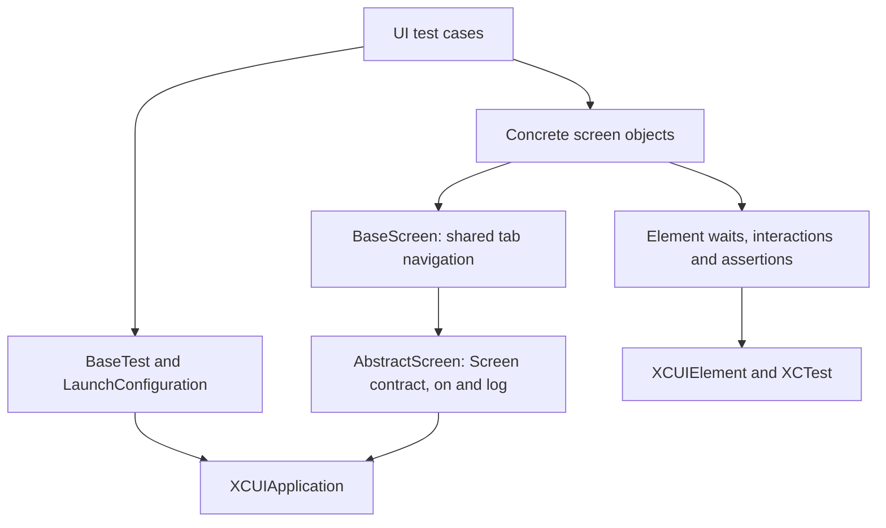

# MovieSwiftUI — iOS UI Test Automation

A SwiftUI movie application extended with an XCTest/XCUITest automation framework. The portfolio focus is the testing layer: reusable screen objects, fluent navigation, explicit synchronization, and failure diagnostics that keep end-to-end tests readable and UI details out of test cases.

## Project Highlights

- Two-layer Page Object Model: app-independent test infrastructure and app-specific screens.
- Typed `.on(Screen.self)` transitions that check the destination screen before continuing.
- Shared tab navigation, interaction helpers, and configurable condition-based waits.
- Accessibility identifiers added to the application for testability.
- Launch-time persisted-state reset and centralized test data.
- XCTest activity logging and screenshots attached when a test fails.

Start with the [test scenarios](MovieSwift/MovieSwiftUITests/Tests/MovieSwiftUITestExamples.swift), [screen objects](MovieSwift/MovieSwiftUITests/POM/Screens), and [framework core](MovieSwift/MovieSwiftUITests/Framework/Core).

## Application & Contribution Scope

The system under test is the existing [MovieSwiftUI application by Thomas Ricouard](https://github.com/Dimillian/MovieSwiftUI). It uses TMDB to browse and search movies, inspect details, and manage personal lists. Its SwiftUI/Combine UI uses SwiftUIFlux for Redux-style actions, reducers, and shared state, with persisted user data. The project contains iOS/Mac Catalyst and tvOS app targets; the UI tests described here target the iOS app.

### Automation contributions

The local history separates the imported application (`f8cc577`) from the automation addition (`dafe25d`, “Framework UI target”, authored by Artem Kupilskyi). The latter adds:

- The `MovieSwiftUITests` target and its inclusion in the shared `MovieSwift` scheme.
- Generic screen contracts, test lifecycle management, waits, assertions, and interaction utilities.
- App-specific screen objects and five UI test methods.
- Accessibility identifiers in SwiftUI views and the `--resetState` launch hook in `AppState`.

The application itself and the existing build workflow are not presented as automation contributions. The original author's [architecture articles](https://medium.com/better-programming/collection-making-a-real-world-application-with-swiftui-4f9bc8c7fb71) provide additional application context.

<details>
<summary>Existing application preview — not a test execution recording</summary>


</details>

## Tech Stack

| Area | Implementation |
|---|---|
| Language | Swift |
| Application | SwiftUI, Combine, SwiftUIFlux |
| UI automation | XCTest / XCUITest, `XCUIApplication`, `XCUIElement` |
| Build and dependencies | Xcode project, `xcodebuild`, Swift Package Manager |
| Synchronization | XCTest existence waits and predicate expectations |
| Diagnostics | `XCTContext` activities and `XCTAttachment` screenshots |
| CI | GitHub Actions, build only; legacy configuration |

The local `Backend` package contains API, image-loading, and preference services; `UI` provides shared application UI elements. Neither is a separate UI test component layer.

## Test Automation Architecture



- **`Framework/` — reusable infrastructure.** `Screen` requires initialization with the app and an `assertIsPresent()` check. `AbstractScreen` supplies typed screen transitions and logging. `BaseTest` applies launch configuration, launches and terminates the app, stops after failures, and captures failure screenshots.
- **`POM/` — application-specific behavior.** `BaseScreen` centralizes navigation to Movies, Discover, Fan Club, and My Lists. Concrete screens keep locators private and expose actions and assertions.
- **`Tests/` and `TestData/` — scenarios and inputs.** Tests compose screen methods; named constants hold the movie title, list name, and cover-search input.

There is no separate business-flow or test-component layer. Shared tab behavior currently uses inheritance through `BaseScreen`, not a `TabBarComponent`.

### Fluent Screen Navigation

This search scenario comes directly from the suite:

```swift
app
    .on(HomeScreen.self)
    .searchForMovie(TestData.Movies.movieTitle)
    .assertFirstResultContains(TestData.Movies.movieTitle)
    .tapOnFirstMovie()
    .on(MovieDetailsScreen.self)
    .assertMovieDetailsAreDisplayed()
```

`.on(Screen.self)` is available on both `XCUIApplication` and `AbstractScreen`: it creates the requested screen, calls `assertIsPresent()`, and returns that typed object. It checks arrival; it does not perform the navigation gesture itself. Action methods such as `tapOnFirstMovie()` perform navigation and return screen objects, but do not themselves call the arrival check.

## Design Decisions

- **Separate infrastructure from app knowledge.** Generic element helpers and test lifecycle code do not contain movie-specific selectors; concrete screens own those selectors and behaviors.
- **Centralize repeated navigation.** Screens inherit tab actions from `BaseScreen`, so individual tests do not repeat tab-bar queries.
- **Expose intent, hide mechanics.** Methods such as `searchForMovie`, `fillNewListInfo`, and `deleteCustomList` encapsulate typing, keyboard handling, cover selection, or swipe-to-delete steps.
- **Configure runs in one place.** `LaunchConfiguration` applies launch arguments and shared timeout settings before launch, rather than scattering setup across tests.

## Synchronization & Test Stability

The [wait helpers](MovieSwift/MovieSwiftUITests/Framework/Extensions/Waits.swift) use `waitForExistence`, `waitForNonExistence`, and `XCTNSPredicateExpectation`/`XCTWaiter` for hittability. Interaction helpers wait before tapping or entering text. Default short, medium, and long timeouts are 3, 5, and 10 seconds and can be configured through `LaunchConfiguration`. The UI test implementation contains no fixed `sleep()` calls.

The helper named `waitUntilVisible` checks **existence**, not viewport visibility or hittability. Text assertions wait for existence and then compare the current text; they do not poll until the text matches. Keyboard dismissal tries available Return, Done, Search, Go, or Send keys.

Every current test launches with `--resetState`, which deletes the persisted `userData` file before state restoration. This is not a full preferences/iCloud reset or a guarantee of isolation; the existing test documentation also notes a possible persistence-timing limitation. The shared scheme randomizes test order.

The suite uses live TMDB responses, not fixtures or network mocks. Availability, search ordering, device language, and network latency can therefore affect outcomes; no flakiness or coverage metrics are claimed.

## Accessibility & Element Identification

App-side identifiers expose controls such as `movieList.searchField`, `buttonWishlist`, and `tabMyLists`, plus dynamic row identifiers such as `movieList.movieRow.<id>` and `customListCell.<id>`. These let screen objects identify controls independently of their displayed text where implemented.

Selectors are not exclusively identifier-based: navigation titles, the Create/Delete buttons, and some list assertions use labels; movie and overview queries also use first-match or positional selection. Identifier use demonstrates testability, not a comprehensive accessibility audit.

## Test Traceability

`AbstractScreen.log()` creates named `XCTContext.runActivity` entries with a log level for screen checks and actions. Assertion helpers forward source file and line information. On failure, `BaseTest.tearDown()` attaches an app screenshot with `.keepAlways` before terminating the app.

These diagnostics are available in Xcode test results. There is no separate `TestTrace` implementation, external report dashboard, or checked-in test execution report.

## Automated Test Scenarios

The [current test class](MovieSwift/MovieSwiftUITests/Tests/MovieSwiftUITestExamples.swift) contains:

| Scenario | Expected behavior |
|---|---|
| Home feed | At least one movie entry exists after launch. |
| Home-to-details navigation | Opening the first movie displays the detail title and overview elements. |
| Movie search | The first result contains the configured title; selecting it displays detail content. |
| Custom list lifecycle | Create a named list with a searched movie cover, assert creation, delete it, and assert removal. |
| Wishlist lifecycle | Search for a movie, add it to the wishlist, verify it in My Lists, delete it, and assert removal. |

Representative wishlist flow:

```text
Launch with state reset → Search → Open movie details → Add to wishlist
    → Open My Lists → Assert entry → Swipe to delete → Assert removal
```

Discover and Fan Club have screen-presence checks and navigation helpers, but no dedicated test scenarios in the current suite.

## Project Structure

```text
MovieSwiftUI/
├── .github/workflows/xcodebuild.yml    # Existing build-only workflow
├── MovieSwift/
│   ├── MovieSwift.xcodeproj/           # App and UI test targets; shared schemes
│   ├── MovieSwift/views/              # SwiftUI application and test identifiers
│   ├── MovieSwiftTV/                  # tvOS app
│   ├── Shared/flux/                   # App actions, reducers, state, models
│   ├── Packages/                     # Backend and UI Swift packages
│   └── MovieSwiftUITests/
│       ├── Framework/
│       │   ├── Core/                 # Screen, AbstractScreen, BaseTest
│       │   ├── Extensions/           # Waits, interactions, assertions, navigation
│       │   └── Utils/                # Launch configuration, timeouts, log levels
│       ├── POM/                      # BaseScreen and concrete Screens/
│       ├── TestData/
│       └── Tests/
├── images/                           # Original application previews
└── LICENSE
```

## Running the Tests

### Prerequisites

- macOS with Xcode and its command-line tools selected.
- An iOS Simulator runtime **26.4 or later**: the current `MovieSwiftUITests` target has an iOS 26.4 deployment target, even though the app targets an older iOS version. Use an Xcode installation supporting that runtime and the XCTest APIs in the source; the repository does not establish a tested minimum Xcode release for this suite.
- Network access for Swift Package Manager dependencies and TMDB. `Backend/services/APIService.swift` currently contains an embedded API key; there is no environment-variable credential setup. If authentication fails, review that configuration without committing replacement credentials.

### Xcode

Open `MovieSwift/MovieSwift.xcodeproj`, let package dependencies resolve, select the **MovieSwift** scheme and a compatible **iPhone simulator**, then press **Command-U**. Use the Test navigator to run a single test. The UI suite exercises the iOS tab-bar layout; macOS and tvOS execution is not established by these tests.

### Command Line

Run from the repository root. Discover eligible destinations rather than assuming a particular simulator is installed:

```bash
xcodebuild -showdestinations \
  -project MovieSwift/MovieSwift.xcodeproj \
  -scheme MovieSwift
```

An iPhone 17 Pro with iOS 26.4 is available in the inspected environment. Run the following, or substitute a compatible destination from your own output:

```bash
xcodebuild test \
  -project MovieSwift/MovieSwift.xcodeproj \
  -scheme MovieSwift \
  -destination 'platform=iOS Simulator,name=iPhone 17 Pro,OS=26.4' \
  -only-testing:MovieSwiftUITests
```

To select just one scenario, replace the final filter with:

```text
-only-testing:MovieSwiftUITests/MovieSwiftUITestExamples/test_SearchFlow
```

For a build without running tests, use `xcodebuild build` with the same project, scheme, and destination. No `.xctestplan` is checked in; test selection is configured in the shared scheme. Inspect results and screenshot attachments in Xcode's Report navigator. Successful execution on a particular Xcode/simulator combination is not asserted by this documentation.

## Continuous Integration

The existing [Xcode build workflow](.github/workflows/xcodebuild.yml) runs on pushes and pull requests targeting `master`. It uses `macOS-latest`, selects `/Applications/Xcode_12.app`, prints the Xcode version, and runs `xcodebuild clean build` for the `MovieSwift` scheme with an iPhone 11 / iOS 14.0 destination.

This is a **legacy build-only configuration**. It does not run `xcodebuild test`, publish test results, or upload screenshots/artifacts. Its pinned Xcode path and simulator must be updated before relying on a current hosted runner; they also do not meet the current UI test target's deployment requirement. No passing CI status or automated UI test execution is claimed.

## Skills Demonstrated

- Swift/XCUITest framework design through protocol-based screen contracts, generics, inheritance, and fluent APIs.
- Maintainable UI scenarios with private selectors and reusable interaction methods.
- Condition-based synchronization, launch configuration, and application testability hooks.
- Test diagnostics through structured XCTest activities, source-aware assertions, and failure attachments.

## Future Improvements

- Modernize the build workflow and add UI test execution with retained `.xcresult` artifacts.
- Introduce controlled network fixtures and strengthen search-result synchronization.
- Replace remaining label/positional selectors and refine persisted-state isolation.
- Extend scenario coverage to Discover, Fan Club, and negative cases; extract shared UI components when reuse justifies it.

## License

Distributed under the [Apache License 2.0](LICENSE). Original application attribution is retained above; this README has been revised to document the automation extension.
